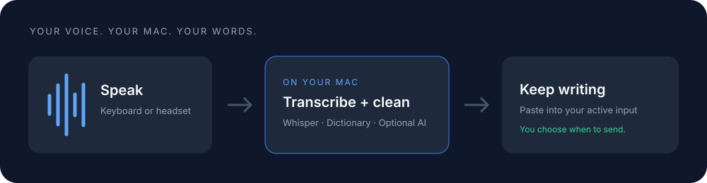
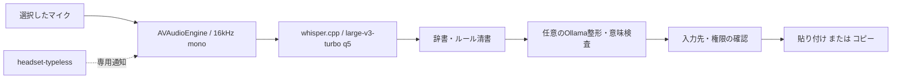

<div align="center">

# Local Dictation

### 話す。整える。いま開いている入力欄へ。

**Apple Silicon Macで動く、ローカル音声入力アプリ。**

Whisperで文字起こしし、辞書と言い直しルールで清書。
必要なときだけローカルAIを使い、ヘッドセットからも操作できます。


[はじめる](#クイックスタート) · [できること](#できること) · [ヘッドセット](#ヘッドセットで使う) · [仕組み](#仕組み) · [よくある問題](#よくある問題)



</div>

> **現在は開発版です。** Apple M2 / 16GBで、右Shift・OpenMoveのボタンによる録音とTextEditへの自動入力を実機確認しています。配布用の公証済みバイナリはまだありません。他サービス全体を上回る精度・速度は主張していません。

## なぜ作るのか

音声入力を日常の道具にしながら、録音・認識・整形を自分のMacで扱いたい。そのための小さなネイティブアプリです。入力する文章の否定や数字が、清書の途中で変わらないことにも気を配っています。

初回セットアップではモデルと依存ソースを取得します。準備後の通常の音声認識は端末内で実行し、任意のAI整形は `127.0.0.1` のOllamaへだけ接続します。AIを使わずに利用することもできます。

## できること

| 機能 | 動作 |
|---|---|
| ショートカット録音 | 1回で開始、もう1回で停止。右Shift単独にも対応 |
| 押している間だけ録音 | キーボードの押下・解放で録音を操作 |
| マイク選択 | システム標準、USBマイク、Bluetoothヘッドセットなどから選択 |
| ヘッドセット操作 | [headset-typeless](https://github.com/miyatsuko10004/headset-typeless)の専用通知で開始・停止 |
| 順次文字起こし | 録音中に音声を分割して認識。録音上限は最大10分 |
| 単語辞書 | 製品名や用語の正しい表記・読みを登録 |
| ルール清書 | フィラー除去と、明示的な同じ単位・曜日の言い直しを処理 |
| 任意のAI整形 | 句読点を整え、意味変更を検出した候補は採用しない |
| AI推敲プレビュー | 原文と比べて手動で採用。自動入力はしない |
| 元の入力欄へ入力 | 入力先を確認して貼り付け。危険な場合はコピー操作へ切り替える |
| メモリへの配慮 | 無操作時に音声モデルを解放し、メモリ不足時は追加AIを省略 |

**送信ボタンやReturnを押す機能はありません。** 文章を確認してから、ユーザー自身で送信できます。

## クイックスタート

### 1. 必要なもの

- Apple Silicon Mac。実機確認は **M2 Mac mini / 16GB**。
- macOS 14以降をビルド対象に設定。実機検証はmacOS 27.2。
- XcodeまたはCommand Line Tools。Package宣言はSwift tools 5.10、実機ビルドはSwift 6.4で確認。
- `git` と `cmake`。AIを使う場合だけOllamaも必要。

```bash
xcode-select --install
# Homebrewを利用している場合
brew install cmake
```

### 2. ソースのディレクトリでセットアップ

```bash
git clone https://github.com/miyatsuko10004/local-dictation.git
cd local-dictation
./scripts/setup.sh
```

このコマンドで音声エンジンとアプリをビルドし、音声モデルを取得・SHA256検証してからアプリを開きます。初回はネット接続とモデルを置くディスク容量が必要です。音声モデル単体は約574MB、ビルド用の依存ソースとキャッシュは別途必要です。

GUIを開かず準備だけ行う場合:

```bash
./scripts/setup.sh --no-open
```

### 3. macOSの許可を設定

- **マイク**：録音時の確認で許可します。
- **アクセシビリティ**：元の入力欄への自動入力に使います。macOSのバージョンによっては「Device Control and Data Access」と表示されます。

マイクの許可だけでも、結果をアプリで確認してコピーできます。

### 4. 入力してみる

1. Local Dictationで音声モデルが準備済みになっていることを確認。
2. 「設定・辞書」でマイクとショートカットを選び、保存。
3. TextEditなどの入力欄へカーソルを置く。
4. ショートカットで録音を開始し、話してから同じキーで停止。
5. 入力された文章を確認。

新規設定のショートカットは **⌘⌥Space**。右Shiftに変える場合は「録音ショートカット → 変更」で右Shiftを押します。既存設定はセットアップで初期化しません。

## ヘッドセットで使う

[Headset Typeless](https://github.com/miyatsuko10004/headset-typeless)と連携すると、Macから離れた場所でもヘッドセットのボタンで録音を操作できます。

```bash
# headset-typelessのソースディレクトリで
./build.sh
./headset-typeless --target local-dictation
```

Local Dictationの設定で:

1. 使用するヘッドセットを「マイク」に選ぶ。
2. 「headset-typelessから録音を開始・停止」をオンにして保存。
3. ボタンで開始 → 発話 → ボタンで停止。

常駐させる場合は手動プロセスを終了してから実行します。

```bash
./install-autostart.sh --target local-dictation
```

専用モードは右Shiftを送らず、フォーカスを移さずに端末内通知を送ります。ボタンは常にトグル動作で、キーボードの押し続け設定とは独立しています。

**確認した機器**：AfterShokz OpenMove（AS660）。実機で開始・停止・発話の認識・TextEdit入力を確認済みです。機種を識別する方式ではなく、すべてのBluetooth機器への対応を保証しません。HFPログの代替経路は実験的で、Siriの起動は抑止しません。再接続・スリープ復帰・長期の反復運用は未検証です。

## マイクの選択と接続変更

選んだマイクは名前ではなく**機器UID**で保存します。「システム標準」は録音開始時の標準入力を選び、その録音の間は同じ機器を使います。

- 指定したマイクが未接続なら、別の機器へ無言で切り替えず開始を拒否。
- 録音中・処理中は設定のマイク選択を無効化。
- 同じ機器の音声形式変更は最大2回・10秒の範囲で復旧。
- 復旧中の短い音声の抜けの可能性を画面で通知。
- 切断・復旧失敗時は停止し、それまでの録音を処理。

## AIを追加する

AIは初期状態ではオフです。辞書とルール清書だけで利用できます。

Ollamaを導入・起動したうえで:

```bash
./scripts/setup.sh --with-ai
```

検証したモデルは **`qwen3:4b-instruct-2507-q4_K_M`**。取得容量は約2.5GBです。既存のOllamaモデルは削除・上書きしません。

| モード | 用途 | 入力への反映 |
|---|---|---|
| AIで句読点も整える | 句読点・空白の整形 | 検査に通った候補だけ採用 |
| AI推敲 | 表現を見直す | プレビュー後に手動採用。自動入力なし |

数字、否定、引用、URLなどの変更を検出した場合は、元の文章に辞書・ルール清書を適用した結果へ戻します。AI整形の入力上限はUTF-8で1,600バイト。超過・接続失敗・出力未完了時も文章を保持します。この検査は、音声認識そのものの聞き間違いを直す保証ではありません。

## データとプライバシー

| データ | 保存先・扱い |
|---|---|
| 設定・辞書 | 開発ビルドでは `.local-data/` |
| 音声モデル・エンジン | `.local-data/` とアプリのResources |
| 作業用WAV | macOSの一時ディレクトリ。完了・中止後に削除 |
| 文字起こし履歴 | 自動保存しない |
| AI整形の接続 | localhostのOllamaのみ。リダイレクト・プロキシ・クラウドモデルを拒否 |

強制終了・電源断では、一時WAVが残る可能性があります。モデルや設定、録音、個人用の検証記録はGitの対象から除外しています。ヘッドセット通知は録音の開始・停止だけを伝え、音声や文章は含みません。通知自体は送信元の認証を提供しないため、明示的にオンにしたときだけ受け付けます。

## 仕組み



通常の認識は、固定リビジョンのwhisper.cppを別プロセスで実行します。モデル取得は明示的な準備時だけ許可し、通常の認識時にはダウンロードしません。録音は順序を保ったチャンクで処理し、古い処理結果や中止した結果が後から入力されるのを防ぎます。

| 部品 | 役割 |
|---|---|
| `Sources/DictationCore/` | 設定、辞書、意味保存検査、ワークフロー、重複除外 |
| `Sources/DictationSpeech/` | 音声認識、チャンク処理、Core Audio機器一覧 |
| `Sources/LocalDictation/` | SwiftUI、録音、ショートカット、フォーカス・貼り付け |
| `Sources/DictationCheck/` | 準備・認識・機器一覧などの検証CLI |
| `Tests/` | Core / Speechの回帰テスト |
| `scripts/` | セットアップ、ビルド、検証・比較ツール |
| `benchmarks/` | 固定ケースと比較結果・測定上の制約 |

WhisperKitは固定依存として残していますが、常用認識はwhisper.cppです。Core ML経路は診断・比較用です。

## 検証結果

2026-10-06時点、Apple M2 / 16GBで:

- Swiftテスト **37件・失敗0**。releaseビルド成功、コードレビュー承認。
- 右Shiftによる録音とTextEdit入力を実機確認。
- OpenMoveのマイク選択・保存・復元、形式変更後の録音継続、ボタンからの入力を実機確認。
- headset-typelessの対象指定6項目、ログ解析7項目、隔離した2プロセス間通知と重複除外を検証。
- LocalVoiceと同じモデル・同じ合成音声46件では正規化後の出力が一致。精度・速度の明確な優位は未確認。
- 固定候補の意味改変検査では危険24件を拒否、正当10件は拒否なし。アプリ全体の精度比較とは別の検査。

詳細は [比較レポート](benchmarks/REPORT.md)。比較作業は現在、入力機器・実用機能の整備より優先度を下げています。合成音声や一度の実機成功を、任意の発話精度や常用の安定性へ一般化しません。

## よくある問題

| 症状 | 確認すること |
|---|---|
| モデル未準備 | 「音声モデルを準備」または `./scripts/setup.sh --no-open` |
| マイクが見つからない | 機器を接続し「再読込」。未接続の指定機器は自動で代替しない |
| 録音できない | macOSのマイク許可、選択した機器、別アプリによる機器使用を確認 |
| 自動入力されない | アクセシビリティ許可と入力先を確認。停止後に別アプリへ切り替えると入力を見送る場合がある |
| 再ビルド後に許可が外れる | アドホック署名では更新のたびに許可が外れる場合がある。下記の開発用署名を使う |
| AIを使用できない | Ollama起動・モデル名・メモリ空き容量を確認。AIなしでも利用可能 |
| ヘッドセットボタンが届かない | bridgeの `--target local-dictation`、アプリ側の連携オン、二重起動、他の再生アプリを確認 |
| Siri画面が出る | HFPログ経路はSiriを抑止しない。必要ならbridgeの `--media-only` を試す |

入力先が変わった場合、パスワード欄、押下中の修飾キーなど、安全に貼り付けできない条件では自動入力を行いません。アプリ内の結果をコピーして利用してください。

## 開発・検証

```bash
./scripts/test.sh
./scripts/build.sh
./scripts/test-headset-ipc.sh

# 一覧取得のみ。録音しない
./.build/release/dictation-check microphones

# 音声を端末内で認識
LOCAL_DICTATION_DATA="$PWD/.local-data" \
  ./.build/release/dictation-check transcribe sample.wav
```

同じMacで開発を続ける場合は、`security find-identity -v -p codesigning` で使う Apple Development 証明書を一つ選び、その40桁のSHA-1を `.local-data/signing-identity` に1行で保存できます。このファイルはGitに含まれません。以後のビルドは同じ証明書で署名し、macOSの許可を更新後も引き継ぎやすくなります。初回の切り替え時は許可し直してください。証明書を指定しない環境ではアドホック署名を使います。`LOCAL_DICTATION_SIGN_IDENTITY` 環境変数を指定するとローカル設定より優先します。

macOS通知サービス・Core Audioへの接続を制限したサンドボックスでは、IPC・実機一覧の検証は実行できない場合があります。通常のユーザーセッションで実行してください。

比較スクリプトは、固定した参照リポジトリ・音声・モデルを `.benchmark/` に準備した開発者向けです。通常のセットアップでは比較用モデルを取得しません。

[変更の提案方法](CONTRIBUTING.md)と[更新履歴](CHANGELOG.md)も参照できます。変更を提案する際は、再現条件、対象マイク・Mac・macOS、関連テストを添えてください。録音や個人の文章、機器UID、ログ内の個人情報は公開Issueへ貼らないでください。

## 現在の範囲と今後

- 現在：ソースからビルドする開発版、日本語入力を中心に検証。
- 未検証：Intel Mac、他機種のヘッドセット、Bluetooth再接続・スリープ復帰、幅広い人の発話。
- 今後の課題：配布署名・公証、接続復帰の検証、比較条件を揃えた認識品質の評価。

ロードマップは予定の保証ではありません。Typeless、Aqua Voice、Shokz、Appleの公式プロジェクトではありません。

## ライセンスと謝辞

本プロジェクトのソースは [MIT License](LICENSE)。依存ライブラリとモデルの条件は [THIRD_PARTY_NOTICES.md](THIRD_PARTY_NOTICES.md) および各配布元を参照してください。

- [whisper.cpp](https://github.com/ggml-org/whisper.cpp) / [OpenAI Whisper](https://github.com/openai/whisper)
- [WhisperKit](https://github.com/argmaxinc/argmax-oss-swift) / [Ollama](https://github.com/ollama/ollama)
- [Headset Typeless](https://github.com/miyatsuko10004/headset-typeless)
- 比較対象：[LocalVoice](https://github.com/ogawa-utnoa/LocalVoice)、[VoiceKun](https://github.com/ahref-org/voicekun)、[localTypeless](https://github.com/tao1587/localTypeless)
